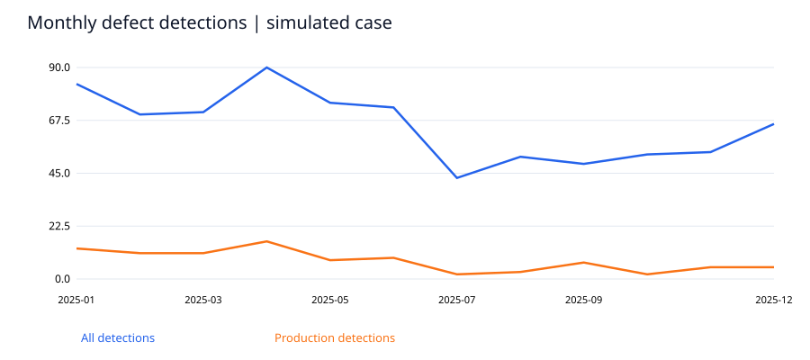
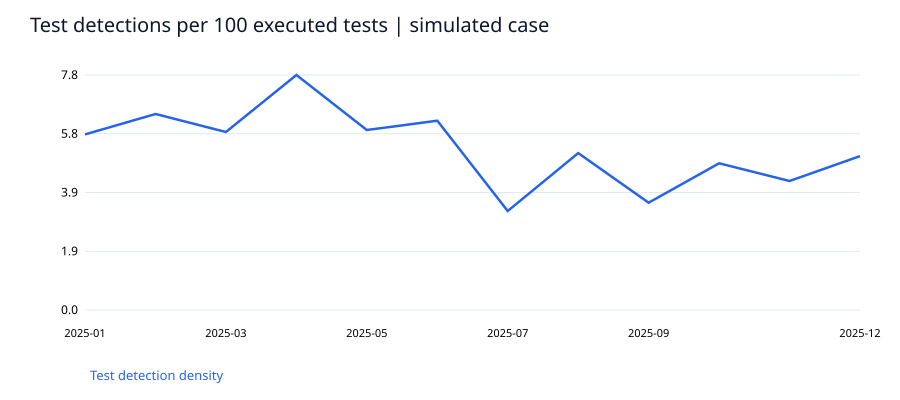

# ソフトウェア品質と欠陥の分析

模擬データ 個人学習プロジェクト。企業の実績や勤務先のデータを示すものではありません。

## 課題
検出件数、テスト規模、本番検出比率、未解決案件を組み合わせて品質上の優先課題を説明できるか。

## 分析方法
データ型・一意性・欠損・時系列を確認し、Pythonで指標を算出。SQLiteで別集計し、件数と主要指標を照合しました。処理結果は results/validation.json に記録しています。

## 主な結果
模擬欠陥779件の本番検出比率は11.8%、クローズ済み解決日数の中央値は17日。最多の記録原因はRequirement（393件）。件数だけでなくテスト実行数との比率を併記した。

## 改善提案
要件レビューとPayment領域の回帰テストを優先する仮説を置く。未解決の高重要度案件を年齢別に点検し、テスト範囲・変更規模・リリース別の情報を追加して検証する。

## 追加の検証と解釈
実行テスト数で正規化したテスト検出密度は前半期6.33件/100テスト、後半期4.33件/100テスト。検出密度の低下は、品質向上だけでなく検出力低下でも生じる。未解決90件を重要度・経過日数で別表にし、クローズ済み中央値の偏りを補足した。

## 解釈上の制約
完全な模擬ケースであり、勤務先の記録ではない。本番検出比率の分母は全検出欠陥で、未知の欠陥を含む真の流出率ではない。テスト密度はテスト検出件数/実行テスト数であり製品の真の欠陥密度ではない。クローズ済み期間は未解決案件の打ち切りバイアスを含む。原因は仮の分類ラベルであり、因果関係の証明ではない。

## 再現手順
Python 3.11以降で `python -m pip install -r requirements.txt` を実行後、`python analyze.py`。ダウンロード不要で同梱データから再現できます。固定seed=20261030。出力先は本フォルダー。分析処理は入力データを変更しません（模擬ケースのraw.csvは生成し直します）。

## 成果物
- report.html：ブラウザーで閲覧可能な分析レポート
- data/fact.csv と DICTIONARY.md：分析用データと定義
- analyze.py：生成・加工・分析・検証の実行コード
- analysis.sql と results/analysis.sqlite：実行済みSQLとDB
- charts/：SVGグラフ
- powerbi/：DAXとDesktop構築仕様（PBIX未作成）
- career_ja.md：LinkedIn紹介文と面接説明

使用技術：Python、Pandas、NumPy、SQLite、SVG。Power BIは設計のみで、実装済みスキルとしては記載していません。

## 図表プレビュー

HTMLレポートはこのリポジトリをダウンロード・展開し、`report.html` をブラウザーで開くと閲覧できます。
